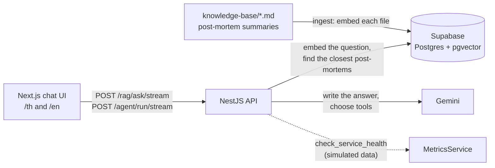

# AI Incident Ops

[](https://github.com/OWNER/REPO/actions/workflows/ci.yml)

A chat assistant for on-call engineers. Describe what is going wrong (in Thai or English) and it
either finds similar past outages in a library of public post-mortems and explains the likely cause
and fix, or lets an agent check service health first and then look up the matching post-mortems.
Answers stream in as they are written and always show which post-mortems they came from.

<!-- Add a screenshot or a short GIF here, for example:  -->

## How it works



**Search mode.** The question is turned into a vector and compared with the stored post-mortems.
Anything below a similarity of 0.60 is dropped. If nothing is left, the API answers "no relevant
post-mortem found" without calling the language model. Otherwise Gemini answers using only the
retrieved text, and the sources are sent to the UI before the first word of the answer.

**Agent mode.** Gemini decides which tool to call: `check_service_health` or
`query_incident_kb` (the same search as above). It can use up to 5 rounds of tools, and each tool
call is shown in the UI as it happens.

**Both modes** keep the last 10 messages as context, so follow-ups like "what if that did not fix
it?" work, and reply in the language of the question.

## Quick start

You need Node 22.12+, [pnpm](https://pnpm.io), [Bun](https://bun.sh), a
[Supabase](https://supabase.com) project and a [Gemini API key](https://aistudio.google.com/apikey).

1. **Database.** In the Supabase SQL Editor, run `data-pipeline/sql/schema.sql`.
2. **Keys.** Copy `.env.example` to `.env` in `backend/` and `data-pipeline/` and fill in
   `GEMINI_API_KEY`, `SUPABASE_URL` and `SUPABASE_SERVICE_ROLE_KEY`. In `frontend/`, copy it to
   `.env.local`.
3. **Load the knowledge base.** `cd data-pipeline && bun install && bun run ingest`
4. **API.** `cd backend && pnpm install && pnpm run start:dev` (port 3001)
5. **UI.** `cd frontend && bun install && bun run dev`, then open http://localhost:3000

## What is in the repository

| Folder | What it is | Details |
|---|---|---|
| [`backend/`](backend) | NestJS 12 API (ES modules, Vitest): search, agent, streaming | [README](backend/README.md) |
| [`frontend/`](frontend) | Next.js 16 chat UI, Thai/English via next-intl | [README](frontend/README.md) |
| [`data-pipeline/`](data-pipeline) | Database schema, ingest script, the post-mortem library | [README](data-pipeline/README.md) |

These are one repository on purpose: the UI depends on the API's streaming format, the API depends
on the table the schema creates, and the ingest script writes to that same table, so a change often
touches more than one of them. Each folder still installs and runs on its own.

## Choices and limits

- **Embedding model and answer model:** `gemini-embedding-2-preview` (768 dimensions) and
  `gemini-3.5-flash-lite`. The first is a preview model, so it may change; switching models means
  re-running `ingest`.
- **Similarity cutoff (0.60) was measured, not guessed.** On this library, clearly unrelated
  questions scored 0.45-0.54 and related ones 0.63-0.86, but questions from a nearby area (for
  example Kubernetes) score about 0.62. No single number separates every case, so the cutoff only
  removes the obvious misses and the prompt ("answer only from the context") handles the rest.
  Re-measure after adding documents.
- **Each post-mortem is stored as one vector.** That works because the summaries are short. Longer
  documents would need to be split into chunks.
- **Service health in agent mode is simulated** (`backend/src/agent/metrics.service.ts`), and the
  UI says so. Swapping in a real monitoring source only means changing that one service.
- **Chats are not saved.** History lives in the browser tab and is sent with each question.
- **No login and no rate limiting**, so this is not ready to be exposed publicly: every request
  spends Gemini quota (the free tier has low limits).
- **The ingest script is safe to re-run:** unchanged files are skipped, edited files are replaced.

## The post-mortem library

`data-pipeline/knowledge-base/` holds short summaries, written for this project in my own words,
of public incident reports. The list of reports comes from Dan Luu's collection,
[danluu/post-mortems](https://github.com/danluu/post-mortems). Newer files have a `Source:` line
linking to the original report; read the original before relying on a detail.

## Tests and CI

The backend has 34 tests (Vitest) that fake the Gemini and Supabase clients, so they run offline
and cost nothing. GitHub Actions runs type-checking, lint, formatting and tests for the backend,
type-checking plus a production build for the frontend, and type-checking for the data
pipeline (see [`.github/workflows/ci.yml`](.github/workflows/ci.yml)).

```bash
cd backend && pnpm test
```
